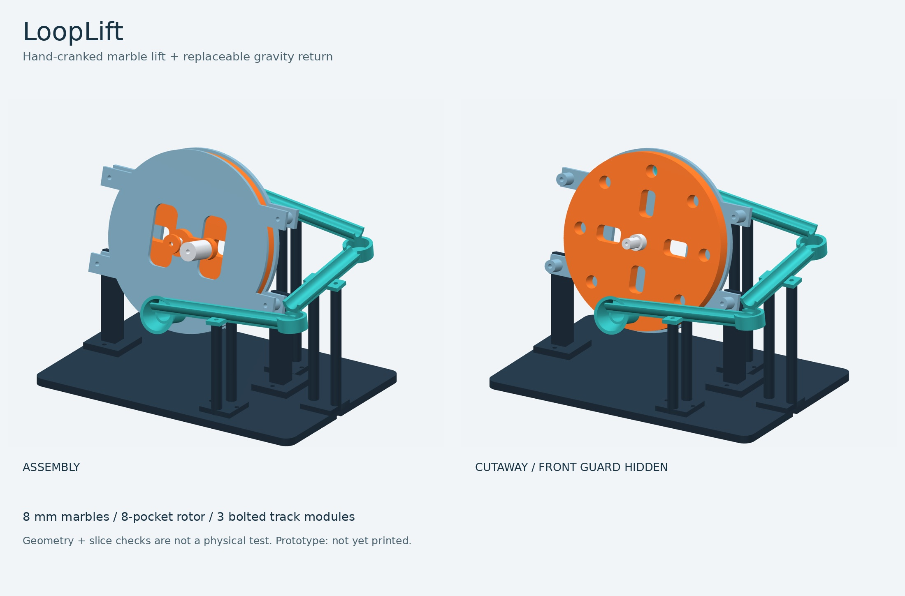
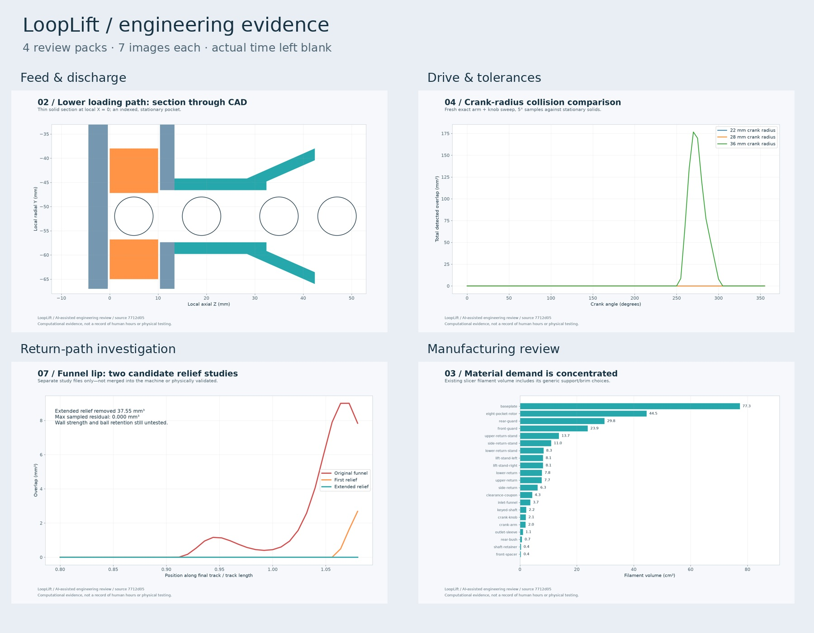
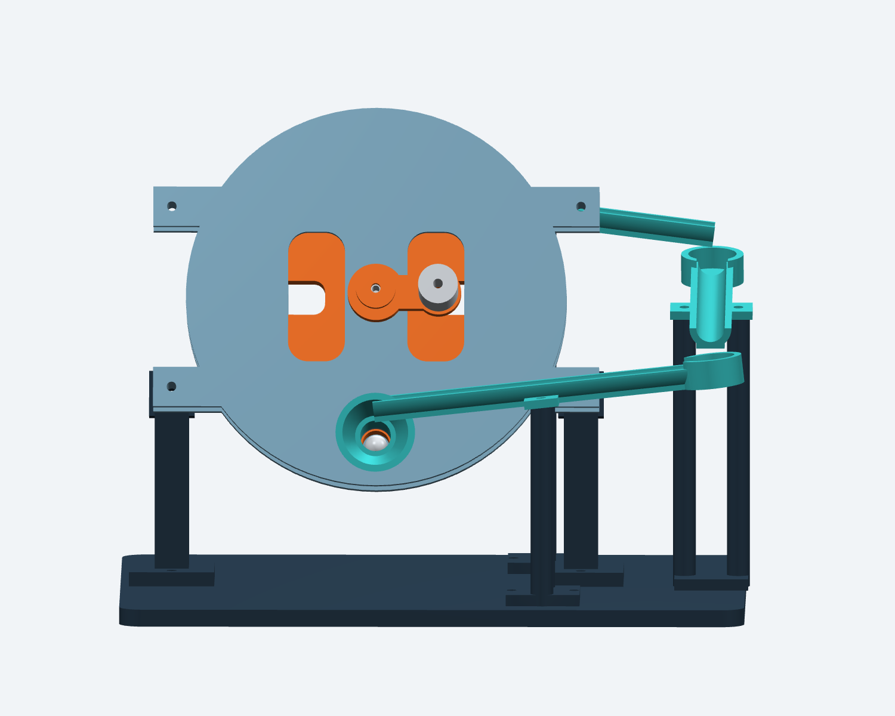

# LoopLift

### Turn a handle. Lift a marble. Send it home.

**A hand-cranked marble-machine design prototype for Half Life CAD week.**

[Download STEP](exports/LoopLift.step) · [Print-part STLs](parts/) · [Coloured GLB](exports/LoopLift.glb) · [Assembly](ASSEMBLY.md) · [What we changed](ATTRIBUTION.md)

[Priced shopping list](shopping/README.md) · [28 evidence images + entry drafts](evidence/README.md) · [Progress reels](media/README.md) · [Study STEP/STLs](evidence/study-parts/)



LoopLift combines an inclined eight-pocket elevator with three removable gravity-return tracks. The intended cycle is simple: a marble enters at the bottom, the hand crank carries it upward, and the return course brings it back. No motor, battery or Raspberry Pi is needed.

**Status: real CAD exports and sliced parts; not yet printed or proven to circulate marbles.** The inlet, outlet and track-to-cup transfers are still physical-test gates. A clear geometry report is not a working-machine claim.

## Latest engineering review and shopping cart

The review found **funnel-lip interference along the final return path and its extension**. An isolated relief candidate clears the sampled path, but is **not installed in the baseline assembly** and has not been qualified for strength, ball retention or physical flow. Corner-transfer calculations are idealised screens, not dynamics validation.

- **Four evidence packs:** seven distinct images and one review draft per pack, with raw results and portable analysis scripts. [Open the evidence](evidence/README.md).
- **Four progress reels:** 43 seconds each, plus the earlier 32-second idea reel. Actual CAD and analysis, music, no added captions or claimed hours. [Watch/download](media/README.md).
- **Amazon UAE shopping snapshot:** four packs, **AED 224.77 ≈ USD 61.20**, checked 19 October 2026. [Prices, exact links and cart evidence](shopping/README.md).
- **Hardware requirements stay separate from purchase packs:** [bom.csv](bom.csv) preserves the original eleven requirement rows; [bom-shopping.csv](bom-shopping.csv) prices four proposed purchase packs without double-counting individual screws.



The entry drafts disclose AI assistance and leave participant time blank. Nothing here is a claim of 27 hours already worked, a physical build or a completed Half Life submission. LoopLift has no electronic “brain module.”

## We checked whether this already exists

Yes. Hand-cranked marble lifts and modular runs already exist. LoopLift is a **credited mechanical remix**, not a claim to have invented either.

The reusable source is [Jan Pieper’s MIT-licensed marble-run](https://github.com/jhpieper/marble-run). We downloaded a pinned copy and ported its straight-track profile into CadQuery. The original code and licence are preserved under [upstream](upstream/).

The [Merbl starter](https://github.com/karnxx/merbl) and [Out Of Marbles bucket lift](https://www.printables.com/model/326261-bucket-lift-modular-marble-machine-handcranked) were also reviewed. Their files are **not** included in this model. Full provenance, licence distinctions and prior art: [ATTRIBUTION.md](ATTRIBUTION.md).

## What makes this version different

| Inherited starting point | LoopLift change |
| --- | --- |
| Circular channel/flat-section construction from a magnetic straight track | Symmetric channel for nominal 8 mm marbles, flat print sole, no magnet holes, M3 mounting tabs and catch cups. |
| A collection of independent magnetic track pieces | Freestanding base and matched-height supports, with a three-stage descending route. |
| Upstream’s separate paddle wheel was inspected only | New eight-pocket rotor, inclined retaining guards, keyed shaft, crank, bushes and axial spacers. |
| No fit-test coupon in the reused straight-track file | Separate clearance coupon, individual bed-oriented exports and a nominal sphere-clearance test. |

The proposed two-route selector and automatic gate are **not implemented** in v0.1. The first milestone is one loop that can be assembled and tested, not a long list of unproven mechanisms.

## How the lift is intended to work

1. Place one nominal **8 mm marble** in the lower funnel with a rotor pocket aligned.
2. Turn the handle slowly. The rotor carries the marble between retaining plates.
3. At the upper opening, gravity along the tilted axis is intended to discharge it into the first track.
4. Three descending troughs and catch cups return it to the lower funnel.

The guards are inclined at **75° to horizontal**. Nominal dimensions include **9.6 mm pockets**, a **10 mm channel inner diameter**, and **0.4 mm rotor-to-guard gaps** on each side. These are starting tolerances—not values certified for your printer.



## What actually ran

The final build has **21 print-part STL files**: 20 installed printed parts plus one clearance coupon. The STEP assembly contains 20 printed components plus a marble proxy; the coupon is deliberately outside the assembly. Fasteners are listed separately, not modeled.

| Check | Result | Evidence |
| --- | --- | --- |
| Component geometry | Nonempty, valid, positive-volume solids | [Geometry checks](checks/geometry-checks.json) |
| Static clashes | No reported overlaps above 0.5 mm³; no evaluation errors | [Geometry checks](checks/geometry-checks.json) |
| Rotor envelope | Conservative rotor-disc sweep clear of stationary components | [Geometry checks](checks/geometry-checks.json) |
| Print meshes | All 21 watertight, consistent, single-component meshes, on the bed and inside a 256 mm envelope | [Mesh checks](checks/mesh-checks.json) |
| STEP export/import | Solid count and volume comparison passed | [Mesh checks](checks/mesh-checks.json) |
| Nominal marble clearance | 24 seated rotor positions and 15 straight-track positions tested | [Path checks](checks/path-checks.json) |
| Crank sweep | Arm and knob checked at 24 angles; no sampled clashes | [Path checks](checks/path-checks.json) |
| Slicing | All 21 parts produced nonempty toolpaths with PrusaSlicer 2.7.2 | [Slicing report](checks/slicing-checks.json) |

A crank/funnel collision was found during the sweep test and the crank radius was reduced. The first track tabs were disconnected; their overlap with the sole was corrected. These fixes are in the generating source, not mesh-repair patches.

**Not verified:** friction, dynamic pickup/release, simultaneous marbles, ballistic catch behaviour, finger clearance, fastener installation, printed tolerances and a continuous working cycle. Start with one ball and stop if it jams.

## Print and build

- Read [PRINTING.md](PRINTING.md) before using the STLs.
- Print the clearance coupon first.
- Use a 256 × 256 mm-class bed for the tested arrangement; the base is nominally 220 × 150 mm and needs brim/margins.
- The generic slice estimated approximately **263 cm³ of filament / 327 g at an assumed PLA density of 1.24 g/cm³** and **36 h 28 min** across separately sliced parts. This is a conservative generic profile, not a printer-specific promise.
- [bom.csv](bom.csv) lists the planned hardware quantities; [bom-shopping.csv](bom-shopping.csv) prices the corresponding packs. The [shopping guide](shopping/README.md) explains compatibility checks and the real guest-cart subtotal.

Keep small balls and loose hardware away from young children and pets. Hand-cranked parts can pinch: operate slowly and keep fingers away from rotor openings. There are no magnets or electrical parts in this version.

## Rebuild from source

Python 3.12 was used. From the repository root:

```sh
python3 -m venv .venv
.venv/bin/python -m pip install -r requirements.txt
.venv/bin/python cad/build.py
.venv/bin/python cad/validate.py
.venv/bin/python cad/check_paths.py
.venv/bin/python cad/render.py

# Requires PrusaSlicer installed; G-code is only a temporary smoke-test artifact.
TMPDIR=/path/to/scratch PRUSA_SLICER=prusa-slicer .venv/bin/python cad/slice_check.py
.venv/bin/python cad/package.py
```

Builds are source-hash keyed under `build/`; `cad/package.py` only publishes the run whose checks all pass. The source uses editable parameters and geometry recipes, not a fully automatic product configurator—changing ball size requires checking all dependent interfaces.

## Before calling it ready

- [ ] Print the coupon and confirm the shaft and ball fits.
- [ ] Assemble the lift and check smooth full rotations without a marble.
- [ ] Test single-ball loading and release while turning slowly.
- [ ] Test each catch cup independently and adjust lips/heights if marbles bounce or stop.
- [ ] Confirm the final return reaches the funnel and completes repeated cycles.
- [ ] Measure wear, fastener retention and stability.
- [ ] Record an actual operating video and document failures as well as successes.

## Authorship, licensing and Half Life

Project direction: **Aalind Tiwari**. Procedural CAD implementation, debugging, tests, rendering and documentation were **AI-assisted with Ava/Hermes**. Inherited track-profile credit: **Jan Pieper**.

Source code is [MIT](LICENSE); generated models/renders are [CC BY 4.0](MODEL-LICENSE.md). Upstream notices remain intact. Retailer screenshots retain their original third-party rights; see [shopping attribution](shopping/README.md#cart-evidence-and-rights). This repo does not imply endorsement or guarantee that Half Life will accept the project. Meaningful personal work and accurate journaling are still required; no hours, print results or acceptance are invented here.
