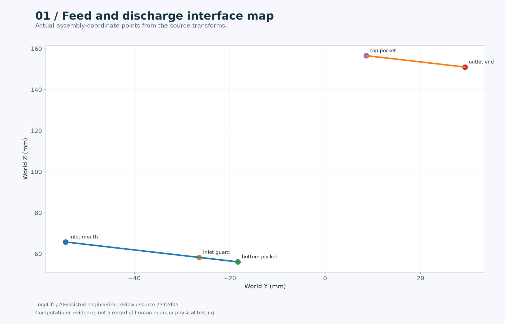
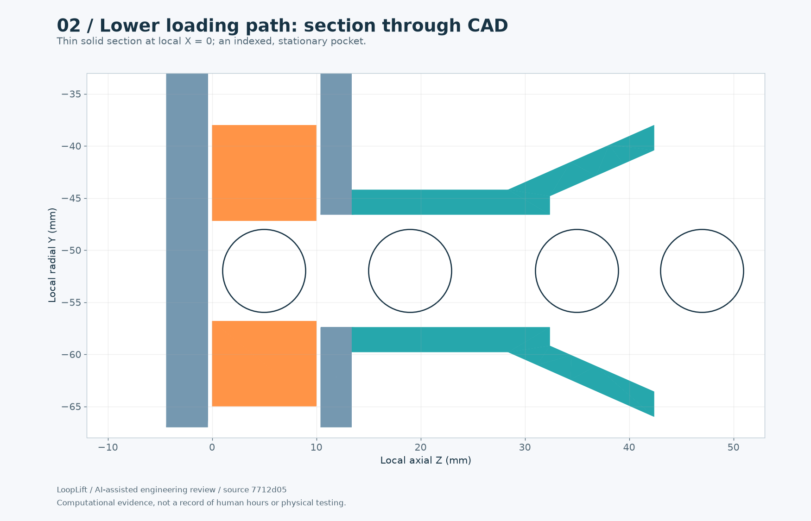
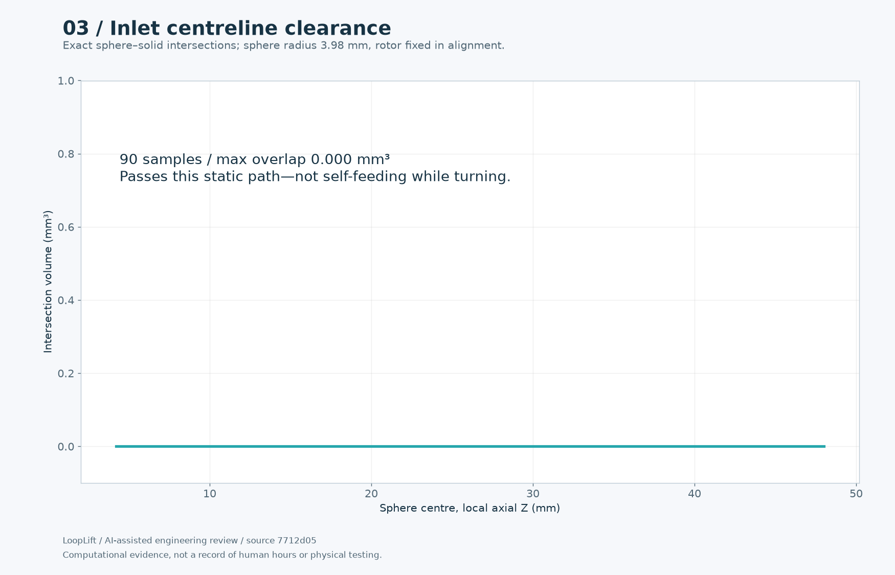
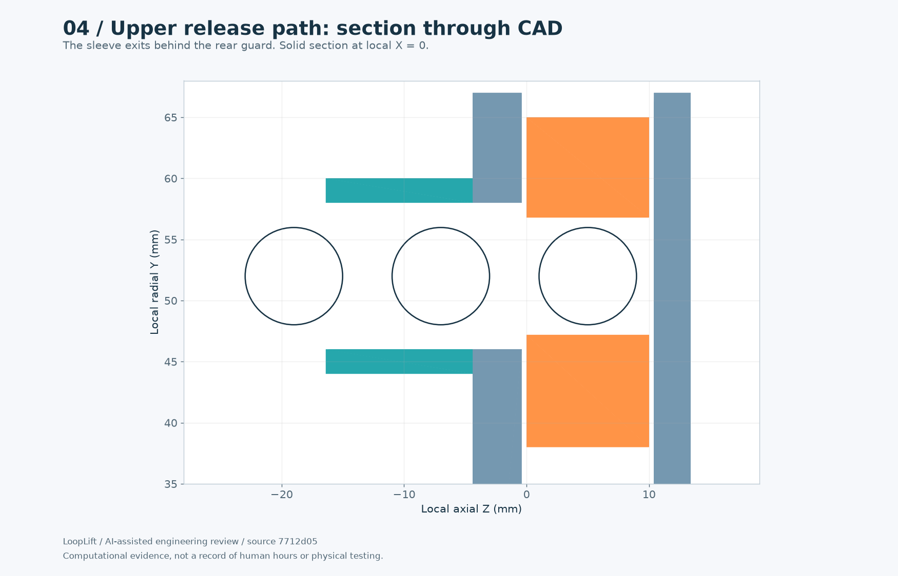
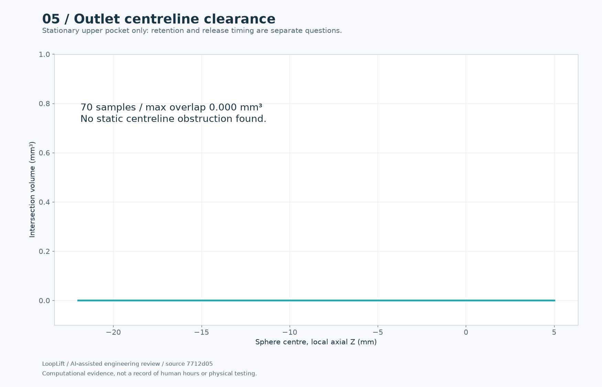
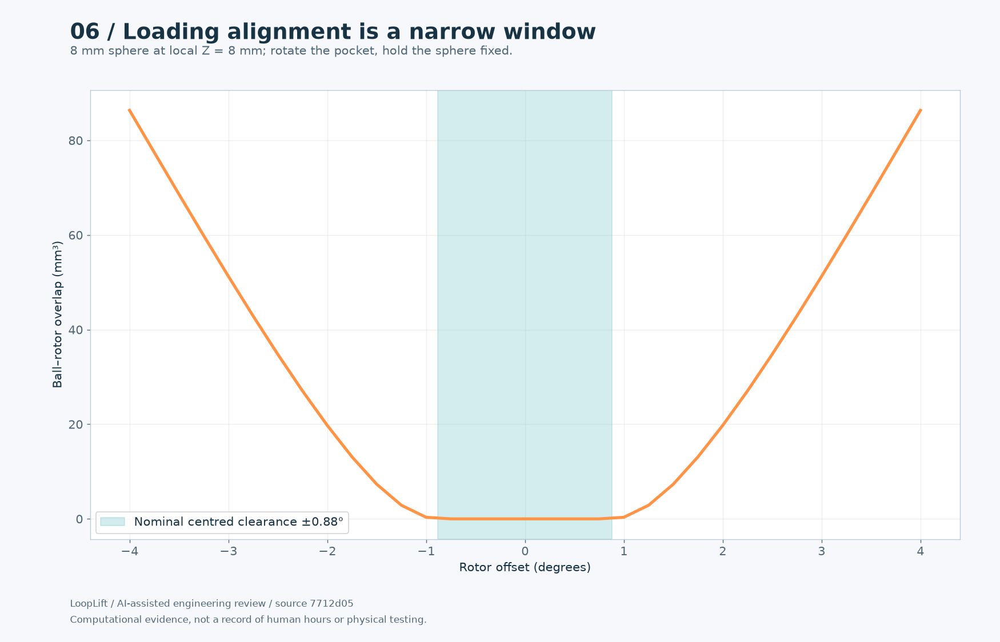
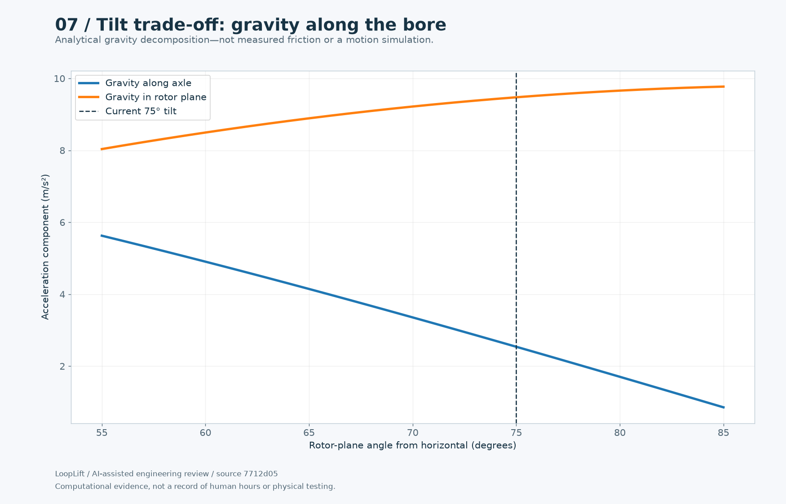

# Pack 1: Feed and discharge

[Entry draft](ENTRY-DRAFT.md) · [All packs](../README.md) · [Progress reel](../../media/README.md)

Computational evidence and explicitly prospective tests. Not a record of a completed multi-hour human session.

## 01-interface-map.png

Source-derived inlet, seated-pocket and outlet world positions.

## 02-inlet-section.png

True CAD section and tested near-contact sphere positions.

## 03-inlet-clearance.png

90 executed Boolean checks along the aligned lower centreline.

## 04-outlet-section.png

Actual upper outlet section with sampled sphere positions.

## 05-outlet-clearance.png

70 exact sphere/rotor/guard/sleeve checks.

## 06-alignment-window.png

Executed indexed entry-angle overlap sweep and geometric angular-clearance limit.

## 07-tilt-gravity.png

Computed decomposition highlights weak axial gravity at steep tilt.

