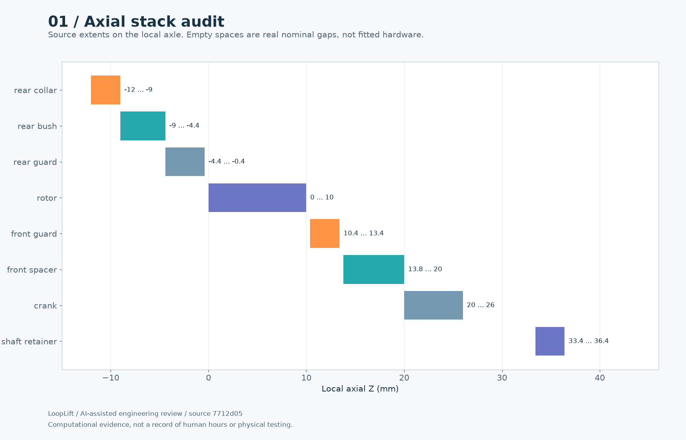
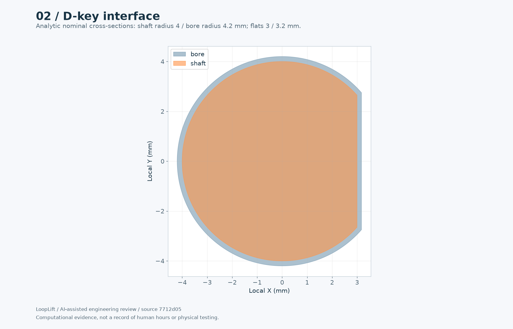
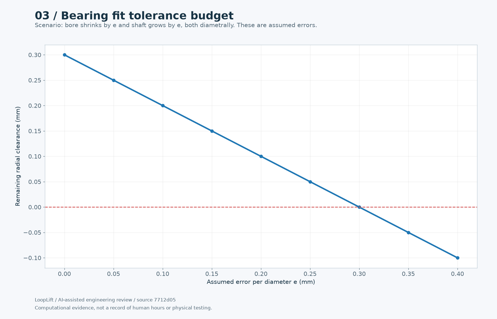
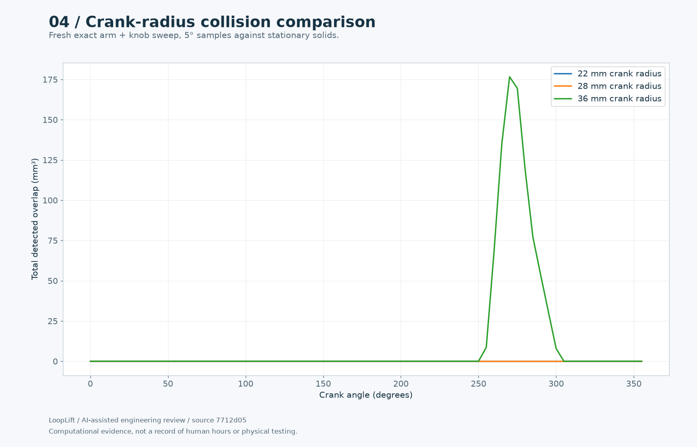
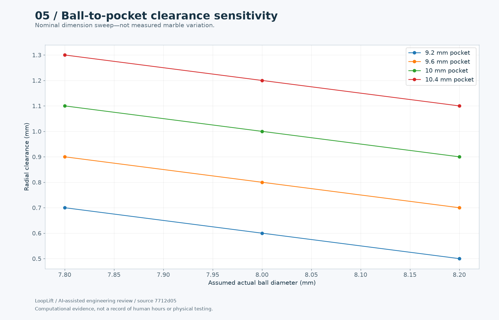
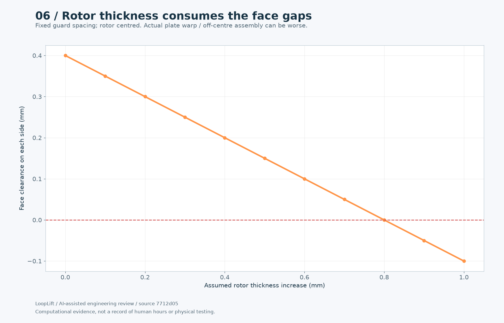
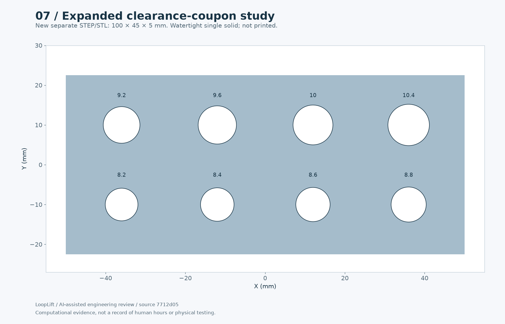

# Pack 2: Drive and tolerances

[Entry draft](ENTRY-DRAFT.md) · [All packs](../README.md) · [Progress reel](../../media/README.md)

Computational evidence and explicitly prospective tests. Not a record of a completed multi-hour human session.

## 01-axial-stack.png

Actual stack reveals spacing between crank and retainer still requires hardware review.

## 02-key-cross-section.png

Source-parameter cross-section; friction and torque capacity not tested.

## 03-bearing-budget.png

Sensitivity of 8.6mm bore/8mm shaft to opposing dimensional errors.

## 04-crank-sweep.png

Recreates collision for 36mm and compares 22mm/28mm candidates; current remains 22mm.

## 05-pocket-budget.png

Computed sensitivity shows why actual ball measurement matters.

## 06-axial-budget.png

Nominal .4mm per side can be lost to thickness variation; not a printer accuracy claim.

## 07-coupon-study.png

Drilled-bore coupon generated and mesh-checked for later measured fit tests.

