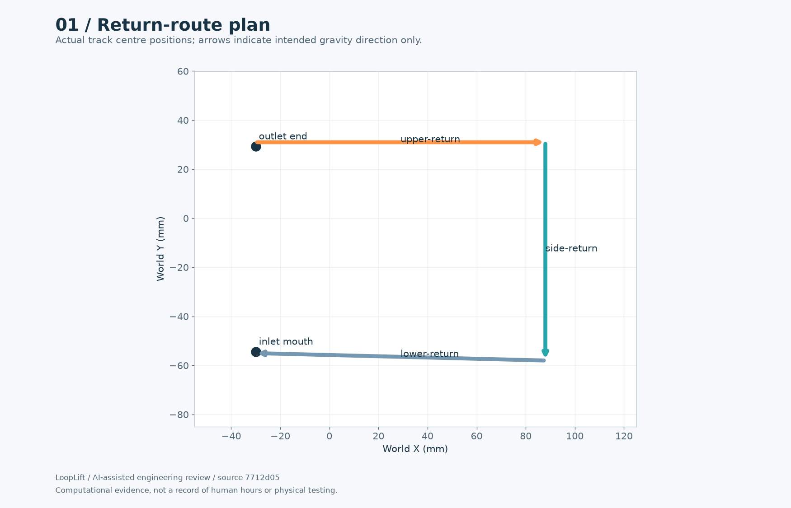
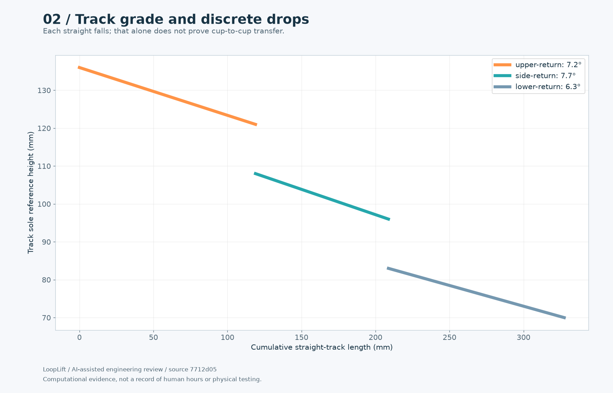
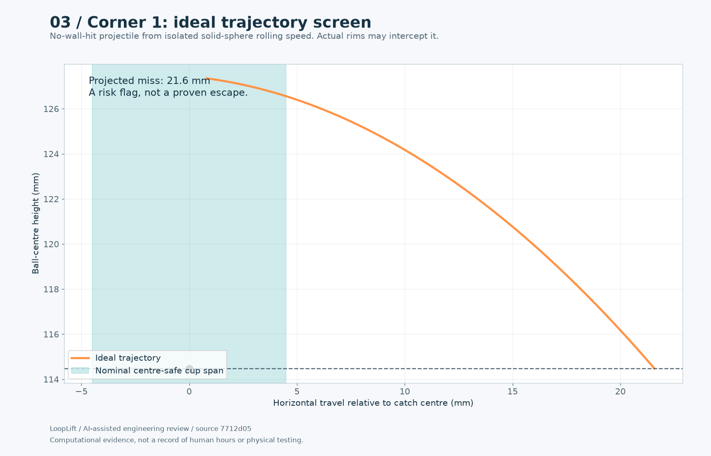
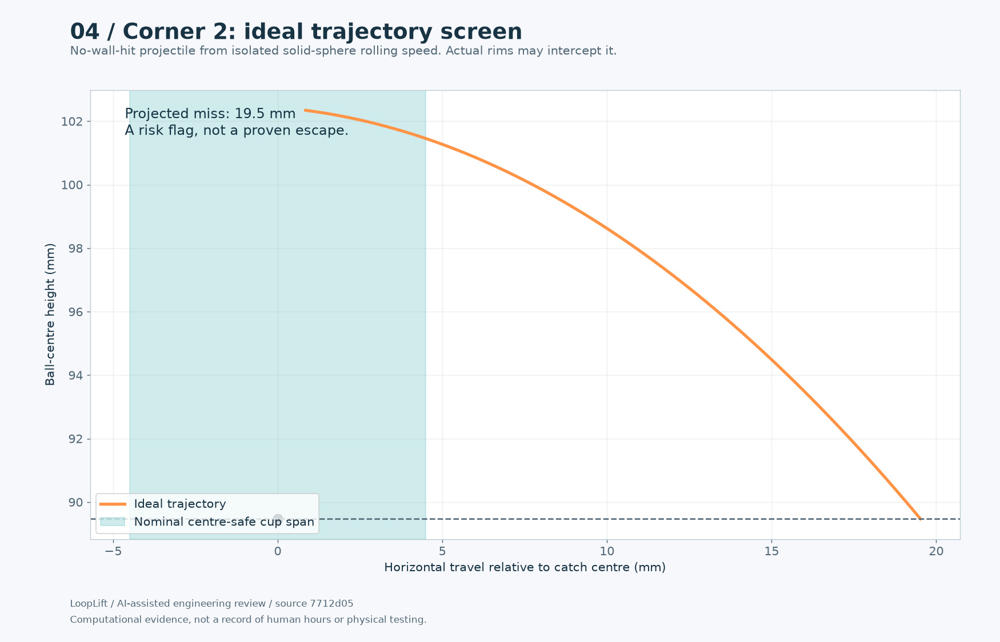
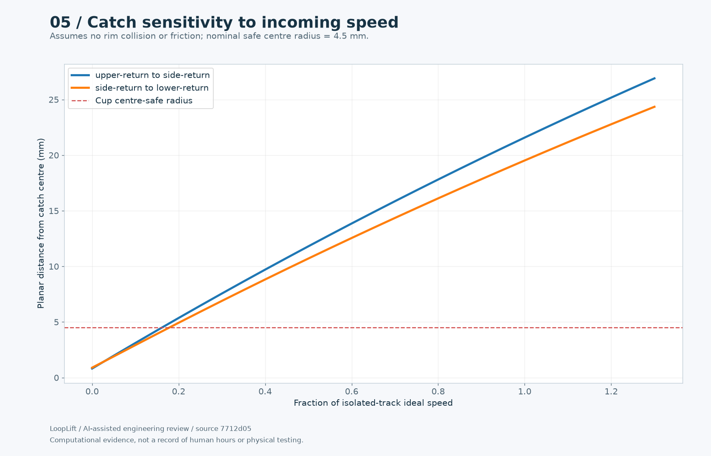
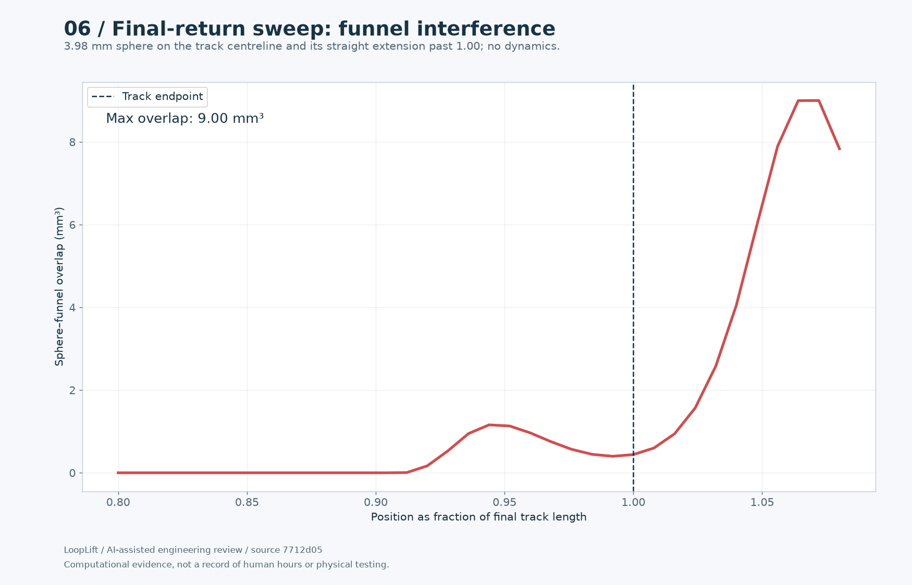
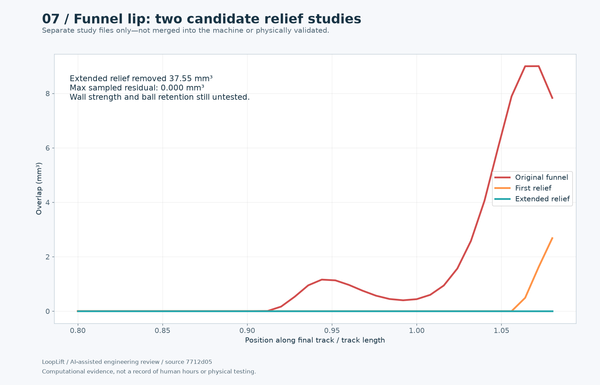

# Pack 3: Return track and funnel study

[Entry draft](ENTRY-DRAFT.md) · [All packs](../README.md) · [Progress reel](../../media/README.md)

Computational evidence and explicitly prospective tests. Not a record of a completed multi-hour human session.

## 01-route-plan.png

Three source-defined return segments and lift interfaces.

## 02-grade-profile.png

Computed lengths, downward grades and vertical discontinuities.

## 03-corner-1-screen.png

Idealised corner-transfer screen with explicit model limitations.

## 04-corner-2-screen.png

Idealised corner-transfer screen with explicit model limitations.

## 05-capture-envelope.png

Velocity sensitivity demonstrates need for physical cup-transfer tests or deeper catcher redesign.

## 06-funnel-collision.png

New measured centreline collision: earlier straight-segment samples omitted this interface.

## 07-relief-comparison.png

Two executed solid-cut candidates, preserved failed first study and passing second sampled clearance.

