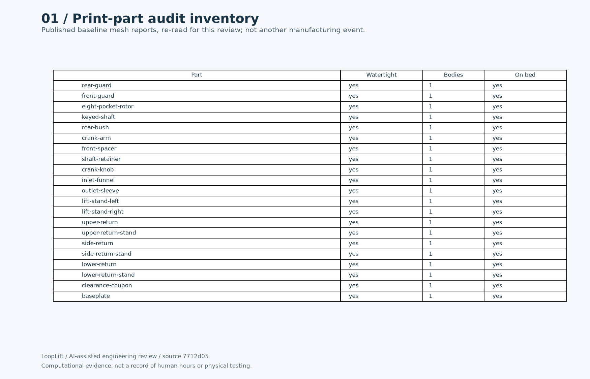
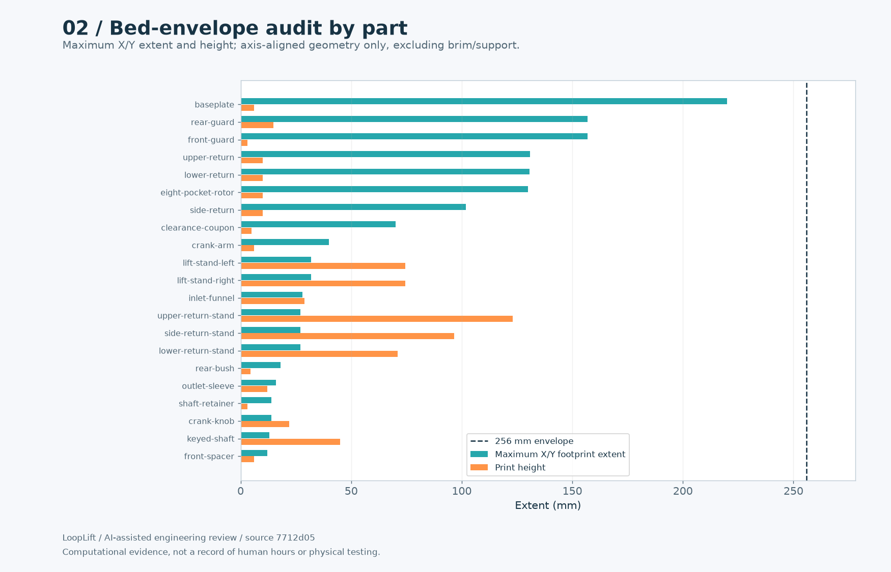
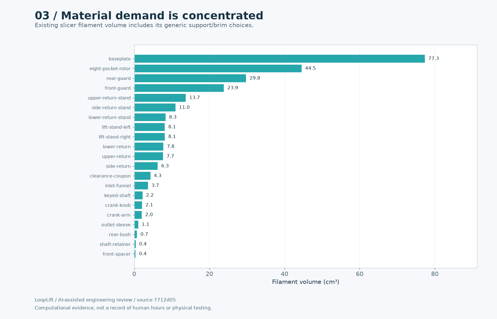
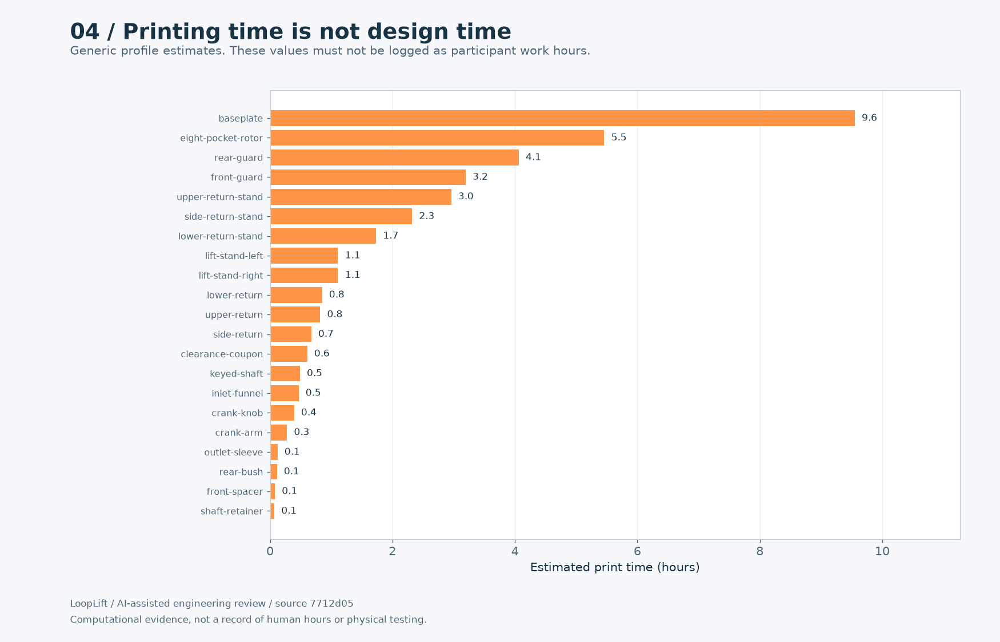
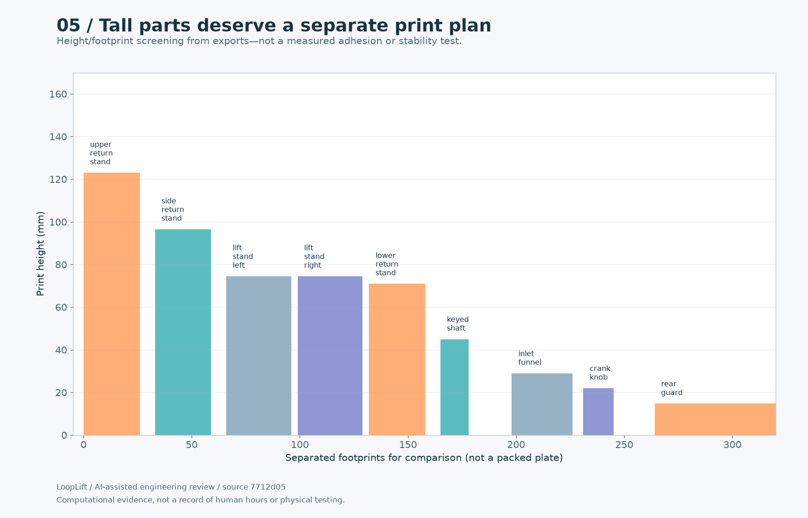
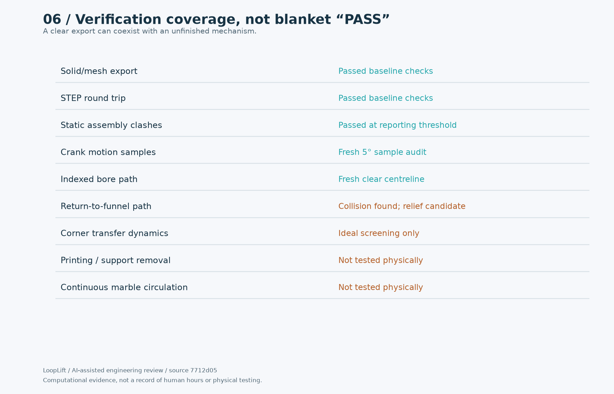
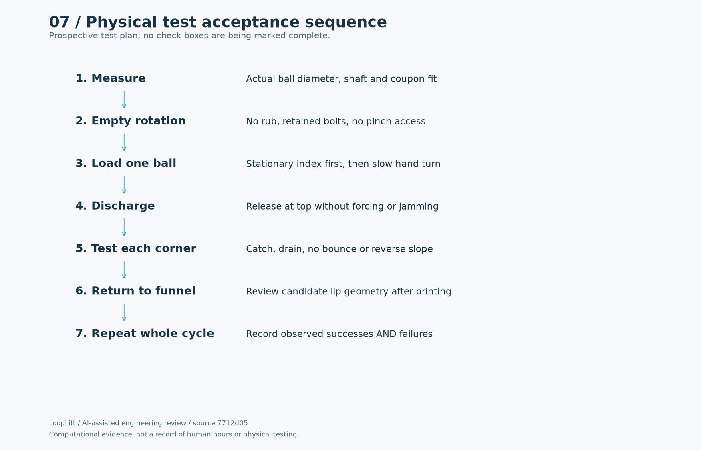

# Pack 4: Print preparation

[Entry draft](ENTRY-DRAFT.md) · [All packs](../README.md) · [Progress reel](../../media/README.md)

Computational evidence and explicitly prospective tests. Not a record of a completed multi-hour human session.

## 01-part-inventory.png

21 individual published part checks; each expected one solid.

## 02-bed-fit.png

All 21 source mesh bounds compared with 256mm envelope; footprint and height separate.

## 03-material-breakdown.png

Per-part slicer filament requirements, not solid-CAD volumes.

## 04-print-time.png

Existing slicer machine-time estimates explicitly separated from human work.

## 05-orientation-risks.png

Source dimensions identify tall supports/shaft; angled faces and nut traps still need layer review.

## 06-coverage-matrix.png

Evidence matrix distinguishes past export validation, fresh audit and remaining physical gates.

## 07-physical-test-plan.png

Unexecuted acceptance plan is explicitly prospective, not fabricated test evidence.

