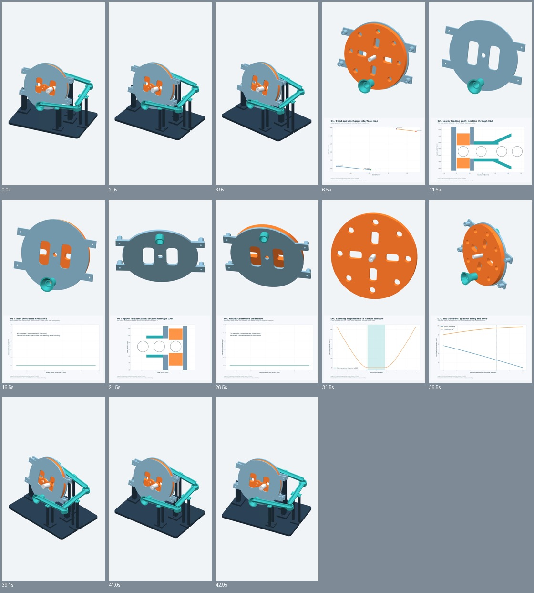
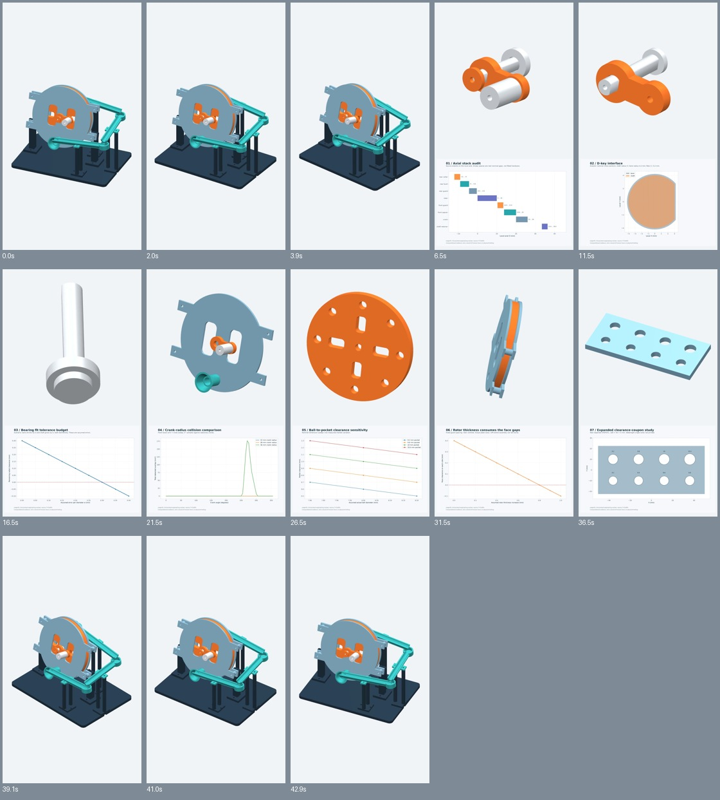
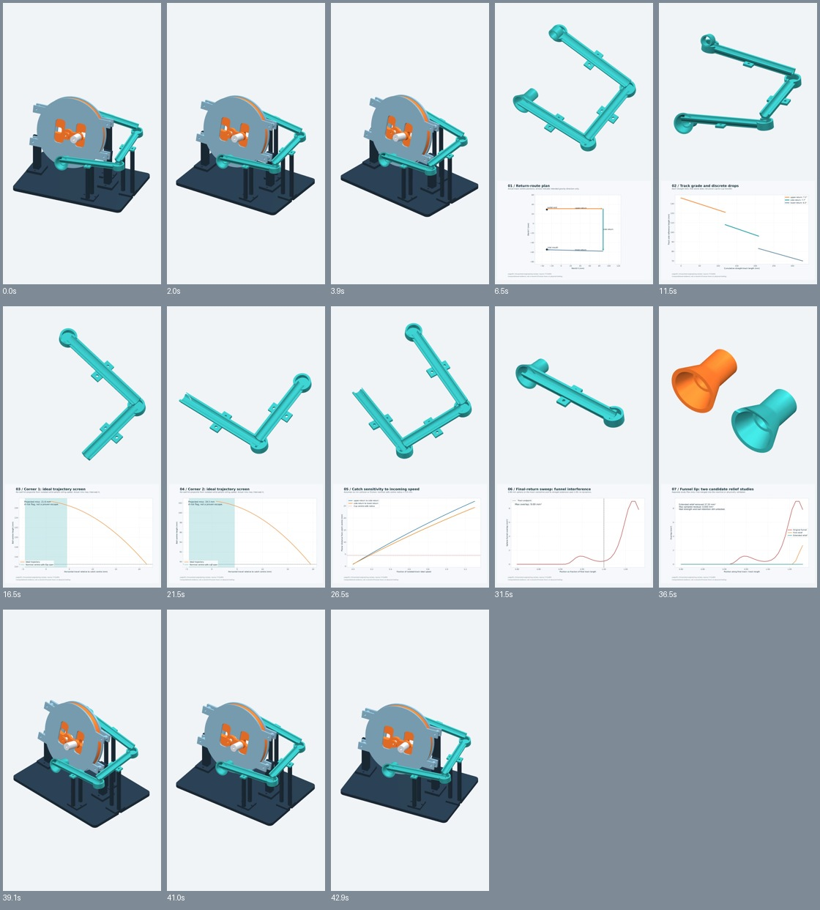
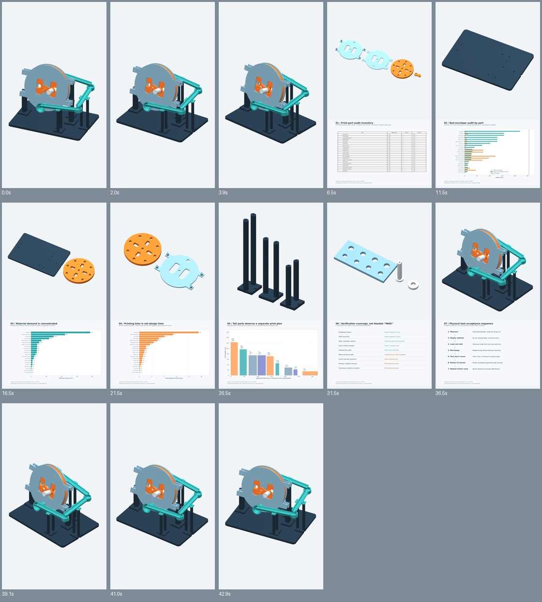

# LoopLift videos

Actual CAD views and engineering evidence. **No physical working-machine demonstration or elapsed-hour claim.** Substantive AI assistance is disclosed in the project README and evidence drafts. Original music and rendering scripts are included.

## Progress reels

Each is 43 seconds, portrait 720×1280, 24 fps, H.264 video and AAC instrumental audio. No added captions or narration; original chart labels remain.

### 1. Feed and discharge

[Watch or download MP4](progress/LoopLift-progress-01-feed-discharge.mp4?raw=1) · [Seven images and entry draft](../evidence/pack-01/README.md)



### 2. Drive and tolerances

[Watch or download MP4](progress/LoopLift-progress-02-drive-tolerances.mp4?raw=1) · [Seven images and entry draft](../evidence/pack-02/README.md)



### 3. Return track and funnel study

[Watch or download MP4](progress/LoopLift-progress-03-return-path.mp4?raw=1) · [Seven images and entry draft](../evidence/pack-03/README.md)



### 4. Print preparation

[Watch or download MP4](progress/LoopLift-progress-04-print-preparation.mp4?raw=1) · [Seven images and entry draft](../evidence/pack-04/README.md)



## Idea reel

[Watch or download the 32-second idea reel](idea/LoopLift-idea-reel-no-text.mp4?raw=1) · [Validation](idea/validation.json) · [Rendering source](idea/build_reel.py)

## Reproduce or inspect

- [Progress rendering source](progress/build_reels.py) and [shot/validation documentation](progress/README.md).
- [Original procedural soundtrack source](assets/make_music.py) and [WAV](assets/beat.wav).
- [Progress delivery manifest](progress/DELIVERY-MANIFEST.json).
- Install the root requirements plus [evidence requirements](../evidence/requirements.txt), and FFmpeg/ffprobe. Run from the repository root:

```sh
python media/progress/build_reels.py --prepare
python media/progress/build_reels.py --pack 1 --preview
python media/progress/build_reels.py --pack 1
# Repeat --pack 2, 3, 4 as needed.
```

The renderer verifies the inventory and CAD source build hash. A later documentation commit does not invalidate unchanged geometry. Candidate parts are shown separately, not silently adopted into the baseline. The progress modal's current requirements were not supplied; these edits are not a guarantee of platform compliance or acceptance.
