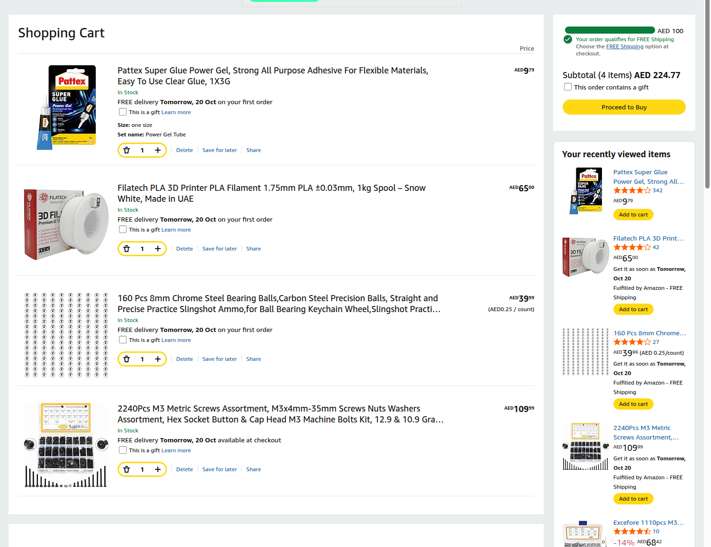

# LoopLift shopping cart — Amazon UAE

**Snapshot verified 19 October 2026:** four packs, quantity **1 each**, subtotal **AED 224.77** (VAT included). Direct conversion at AED 3.6725/USD is **about USD 61.20**. Rounded individual USD form rows sum to **USD 61.21**; that one-cent difference is rounding, not another charge.

The guest cart showed free-shipping eligibility if that option is chosen. Final checkout, delivery to the buyer's address and payment were not completed. Prices and stock can change. This is **not an order confirmation**, not funding approval, and not a cart shared into the user's Amazon account.

| Purchase pack | Qty | AED per pack | Approx USD per pack | Direct product |
|---|---:|---:|---:|---|
| M3 hardware assortment, 2240-piece kit | 1 | 109.99 | 29.95 | [Amazon UAE](https://www.amazon.ae/dp/B0G3V4JPWC) |
| Nominal 8mm steel balls, 160-pack | 1 | 39.99 | 10.89 | [Amazon UAE](https://www.amazon.ae/dp/B0D86NS9JB) |
| Filatech PLA 1.75mm, 1kg spool, Snow White | 1 | 65.00 | 17.70 | [Amazon UAE](https://www.amazon.ae/dp/B07MGCJS68) |
| Pattex Super Glue Power Gel, 3g | 1 | 9.79 | 2.67 | [Amazon UAE](https://www.amazon.ae/dp/B09KCHGRZF) |

[Download the priced CSV](../bom-shopping.csv) · [Original requirements BOM](../bom.csv) · [Structured shopping manifest](shopping-manifest.json)

## Requirement coverage and fit checks

- **M3 kit:** covers the listed M3×8, ×12, ×20, ×30 and ×35 lengths, M3 nuts and flat washers. Product text and the size chart were checked; advertised quantities exceed the build requirements. Includes substantial spare hardware. Do not price loose screws again as additional purchases.
- **Machine screws are not dedicated plastic-thread-forming screws.** The track and shaft-retainer pilots require a measured fit test and may need suitable tapping/pilot changes or a different retainer screw. Head clearance, grip length and the washer stack are not validated. The kit is a prototype allowance, not a certified drop-in fit.
- **Balls:** 160 nominal 8 mm steel spheres; only one is needed for initial testing. The listing's steel-grade descriptions are inconsistent, and its precision tolerance is not established. Measure the actual diameter. These are loose spheres, not complete 608 bearings or magnets.
- **PLA:** 1 kg of 1.75 mm Snow White PLA. The existing generic slice estimated about 327 g for the baseline; extra test pieces/revisions use more. This is a single-colour purchase, not the multicolour appearance of the CAD renders.
- **Glue:** 3 g cyanoacrylate gel for the funnel/sleeve mating faces only. Test on scrap PLA, keep bores clear and follow the label's skin/eye/ventilation precautions.

There is **no brain module, controller, Raspberry Pi, battery or motor** in LoopLift's hand-cranked design. Do not copy an unrelated form placeholder into this BOM.

## Copyable Half Life purchase rows

Use these four pack rows if the platform accepts consolidated purchase packs. They do not automatically replace the platform's existing entries. Preserve the per-part requirements separately; never claim the unpriced requirements are free.

```text
PART: M3 hardware assortment, 2240-piece kit
WHAT IT'S FOR: Fasteners for guards, stands, crank and track tabs; pilot and head fit still require testing.
QTY: 1
UNIT $: 29.95
VENDOR: Amazon.ae
LINK: https://www.amazon.ae/dp/B0G3V4JPWC
```

```text
PART: Nominal 8mm steel balls, 160-pack
WHAT IT'S FOR: Nominal 8 mm ball for lift/return tests, with spares; measure the actual ball.
QTY: 1
UNIT $: 10.89
VENDOR: Amazon.ae
LINK: https://www.amazon.ae/dp/B0D86NS9JB
```

```text
PART: Filatech PLA 1.75mm, 1kg spool, Snow White
WHAT IT'S FOR: Material for prototype parts, fit coupons and revisions.
QTY: 1
UNIT $: 17.70
VENDOR: Amazon.ae
LINK: https://www.amazon.ae/dp/B07MGCJS68
```

```text
PART: Pattex Super Glue Power Gel, 3g
WHAT IT'S FOR: Attach funnel and outlet sleeve after dry-fitting; keep bores clear.
QTY: 1
UNIT $: 2.67
VENDOR: Amazon.ae
LINK: https://www.amazon.ae/dp/B09KCHGRZF
```

## Cart evidence and rights



This is a crop of a real browser capture, not a generated shopping mock-up. Only browser navigation/location was removed; product rows, quantities and subtotal were not edited. It records the **cart subtotal**, not a final checkout invoice. A programme requiring a final checkout screenshot needs fresh checkout evidence from the buyer.

Amazon and seller interface/product imagery retain their respective rights and are included as factual purchasing evidence; the repository's generated-model licence does not relicense them. The private photograph of the user's laptop/form is not published.
